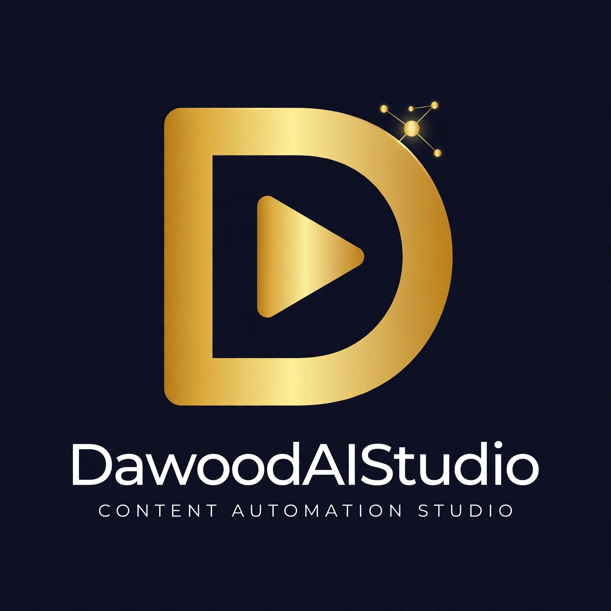

# DawoodAIStudio — Content Automation Studio



An **Agentic AI studio** for YouTube and Facebook creators, built with
**LangGraph multi-agents + RAG** and a **Streamlit** dashboard.

Give it a **topic** → get a Critic-checked YouTube + Facebook content package.
Give it a **link** → get a fresh, original script with a new angle.
Give it a **long video you own** → get ready-to-post vertical clips + a full editing plan.

> **Cost: $0.** Every library is open source and the only API used is the
> **Google Gemini free tier** (no credit card, ever). You run it on **your own
> free key** — nobody pays anything.

**🔗 Live app:** https://creatorcrew-rag.streamlit.app
**💻 Code:** https://github.com/mdawood12/CreatorCrew-RAG

---

## ✨ What the studio does

| Module | What it does |
|---|---|
| **🏠 Home Dashboard** | Live stats at a glance — documents indexed, scripts generated, clips rendered, API key status |
| **🤖 Content Studio** | A 4-agent team (Planner → RAG Researcher → Scriptwriter → Critic, max 2 revision rounds) writes a full YouTube + Facebook package from one topic |
| **📚 RAG Knowledge Base** | Real viral transcripts + official YouTube/Meta policy documents, chunked into local **ChromaDB** with local embeddings; answers come with citations |
| **🔗 Link Transformer** | Extracts the ideas from a video/article link (captions → yt-dlp subtitles → local Whisper fallback chain) and writes an **original** script — originality is *measured* with an n-gram overlap check (limit 25%), not just claimed |
| **✂️ Viral Splitter** | Finds highlight scenes in a long video and renders 9:16 clips with FFmpeg (reframe, grade, hook overlay, loudness master) + per-clip download buttons and sidecar JSON |
| **🗂️ Transformation Planner** | Builds a deterministic 7-stage editorial editing plan (hook → audio cleanup → trimming → framing → color grade → voiceover/captions → final mix) for commentary-driven videos |
| **📊 Evaluation & History** | LLM-as-a-Judge scoring + optional RAGAS; every output is saved in History |
| **🧠 Memory** | Your creator profile (niche, audience, tone) is saved once and used in every generation |
| **🔑 Key Resilience** | A **pool** of free Gemini keys with health checks and automatic failover — if one key hits its daily quota, the app switches by itself |
| **🆓 Demo Mode** | No key yet? The app still opens and shows sample outputs |

> **Rights first:** the Splitter and Planner only process videos you declare
> rights to (your own / licensed / public-domain / Creative Commons), and the
> declaration is saved with every clip. All transformations are normal
> editorial edits — the studio contains **no** detection-evasion tricks, by design.

---

## 🚀 Step-by-step: run it on your PC (Windows)

### Step 1 — Install the two prerequisites
1. **Python 3.12** from [python.org](https://www.python.org/downloads/) (tick *"Add Python to PATH"* during setup).
2. **FFmpeg** — open Command Prompt and run:
   ```bat
   winget install Gyan.FFmpeg
   ```
   Close and reopen the terminal afterwards.

### Step 2 — Get the code
```bat
git clone https://github.com/mdawood12/CreatorCrew-RAG.git
cd CreatorCrew-RAG
```
(No Git? Download the ZIP from the GitHub page → *Code → Download ZIP* → extract.)

### Step 3 — Create the environment and install
```bat
python -m venv .venv
.venv\Scripts\activate
pip install torch --index-url https://download.pytorch.org/whl/cpu
pip install -r requirements.txt
```
⏳ The first install is the slow one (torch is large). Later runs are instant.

### Step 4 — Get your free Gemini API key (2 minutes, no card)
1. Open [aistudio.google.com/apikey](https://aistudio.google.com/apikey) and sign in with Google.
2. Click **Create API key** → copy the key (it starts with `AQ.`).
3. In the project folder, copy `.env.example` and rename the copy to `.env`.
4. Open `.env` and paste your key like this:
   ```
   GOOGLE_API_KEYS=your-key-here
   ```
   💡 You can paste **several keys**, comma-separated — the app rotates them automatically when one runs out of daily quota.

### Step 5 — (Optional) Add your own knowledge
Put transcripts, policy PDFs or notes into `data\raw\` — the app indexes them
into its knowledge base. On the **live** app this happens automatically on
first run; on your PC you can also run:
```bat
python -m src.ingest
```

### Step 6 — Run the studio
```bat
streamlit run app.py
```
Your browser opens at **http://localhost:8501**. Done 🎉

---

## 🖱️ Step-by-step: using the studio

### First time only — set your profile
1. In the left sidebar, open **Creator Settings**.
2. Fill in your **niche, target audience and tone** → **Save**. Every script is now written in your style.

### Content Studio (your daily driver)
1. Open the **Content Studio** tab.
2. Type a topic (e.g. *"Why do cats always land on their feet?"*) → **Generate**.
3. Wait ~1 minute while the four agents work.
4. Read the **YouTube package** (hook, script, CTA, SEO title, description, tags) and the **Facebook package** (reel hook, pacing notes, caption).
5. Use the **Copy / Download** buttons — the package is also saved in History automatically.

### Link Transformer
1. Open the **Link Transformer** tab.
2. Paste a YouTube/article link → **Transform**.
3. Get a brand-new script built from the *ideas* — with the originality overlap % shown, so you can see it is not a copy.

### Viral Splitter (your own long videos)
1. Open the **Viral Splitter** tab.
2. **Step 1:** Tick the **rights declaration** (own / licensed / public-domain / CC) and write the source note.
3. **Step 2:** Upload your video (max 500 MB) or paste a direct media link.
4. **Step 3:** Click **Create clips** → download each finished 9:16 clip.
5. **Step 4 (optional):** Fill platform, niche and commentary angle → **Generate plan** → download the 7-stage Transformation Plan (JSON) and follow it in your editor.

### Evaluation & History
- Every script and clip you generate is listed here — reopen, copy or download any past output.

---

## ☁️ Step-by-step: deploy it live (Streamlit Cloud, free)

1. Push this repo to **GitHub** (the repo must be **Public** — Streamlit's free deployer reads public repos).
2. Go to [share.streamlit.io](https://share.streamlit.io) → sign in with GitHub → **Create app → Deploy a public app from GitHub**.
3. Select: **Repository** `CreatorCrew-RAG`, **Branch** `main`, **Main file** `app.py`.
4. Open **Advanced settings**:
   - **Python version:** `3.12`
   - **Secrets:** paste your real key (⚠️ the *actual* key from your `.env` — never a placeholder):
     ```
     GOOGLE_API_KEYS = "your-real-key-here"
     ```
5. Click **Deploy**. First build takes a few minutes — the knowledge base builds itself automatically on first run.
6. Your app is live at `https://<your-app-name>.streamlit.app`.

**Two files that make the live app work — do not delete them:**
- `packages.txt` — contains `ffmpeg`, so the cloud server can render clips (without it, the Splitter fails with *"No such file or directory: 'ffmpeg'"*).
- `.streamlit/secrets.toml` is **never** committed — keys live only in the Streamlit Secrets box.

> **Sharing rule:** share the **GitHub link** freely (each person runs it with
> their own key). Keep the **live link** for demos — all visitors share your
> key's free daily quota and one shared History.

---

## 🛠️ Troubleshooting

| Problem | Fix |
|---|---|
| *"All API keys are down"* on the live app | Your Streamlit **Secrets** hold a wrong/placeholder key. Open *Manage app → Settings → Secrets*, paste the real key from your `.env`, **Save**, then *Reboot app* |
| *"No such file or directory: 'ffmpeg'"* (live Splitter) | `packages.txt` with the word `ffmpeg` is missing from the repo root — add it and let the app redeploy |
| *Documents indexed: 0* on PC | Add files to `data\raw\` and run `python -m src.ingest` |
| Daily quota reached | Add another free key to `GOOGLE_API_KEYS` (comma-separated) — the app fails over automatically |
| A key leaked | Delete it in AI Studio and create a new one (1 minute). Never commit `.env` — it is git-ignored |

---

## 🏗️ Project structure

```
app.py                Streamlit UI (no business logic)
src/
  config.py           settings, KeyManager (pool + failover), LLM factory
  ingest.py           load → chunk → embed (local) → ChromaDB (idempotent)
  memory.py           SQLite creator profile + output history
  schemas.py          Pydantic v2 contracts for agent hand-offs
  tools.py            RAG retrieval + transcript fallback chain
  agents.py           LangGraph team: Planner/Researcher/Writer/Critic
  transformer.py      link → ideas → original script (+ overlap audit)
  splitter.py         long video → highlight clips (FFmpeg, rights gate)
  planner.py          7-stage Transformation Planner (rights gate)
tests/
  test_rag.py         smoke & relevance tests (no key needed)
  evaluate_ragas.py   optional RAGAS + LLM-as-a-Judge evaluation
packages.txt          cloud system package: ffmpeg
```

Design patterns: **Supervisor/Router**, **ReAct tool use**, **bounded
self-critique (≤ 2 revisions)**, **dual-layer memory**, **strict data contracts**.

## 🔐 Honest limits

- **Free-tier limits are limits, not prices** — Gemini free quota is roughly 1,500 requests/day per key; the key pool + backoff handles it.
- **Scale:** local ChromaDB is comfortable to ~100k chunks; SQLite suits a single creator.
- **UI:** Streamlit is desktop-first and usable on mobile.

## 📄 License

MIT — free for anyone to use, learn from, and build on.
